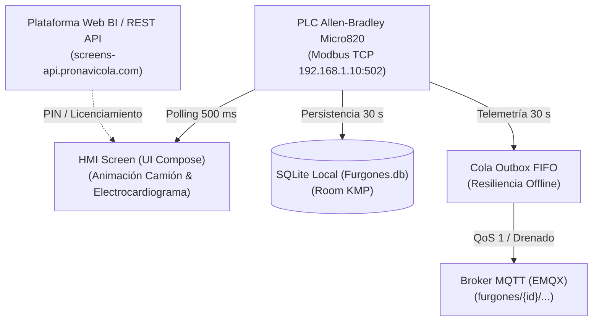

# Especificaciones Arquitectónicas y Técnicas - Camion Android

Este documento detalla la arquitectura, flujos de datos, frecuencias de muestreo/persistencia y especificaciones de comunicación del sistema **Camion Android**, aplicación desarrollada en **Kotlin Multiplatform (KMP)** y **Compose Multiplatform** para el monitoreo y control de furgones de transporte avícola en tiempo real.

---

## 1. Visión General del Sistema

La solución reemplaza la aplicación de cabina legacy basada en WPF (.NET) y opera sobre tablets o computadores industriales de a bordo conectados directamente por Ethernet/Wi-Fi al PLC de control de clima del furgón y a la nube vía MQTT/REST.



---

## 2. Estrategia de Polling, Muestreo y Persistencia (Frecuencias Temporales)

Para garantizar una experiencia de usuario en tiempo real sin degradar la memoria flash del dispositivo ni sobrecargar el tráfico móvil, el sistema implementa una **separación estricta de frecuencias temporales**:

| Capa / Proceso | Intervalo / Frecuencia | Propósito y Comportamiento | Componentes Responsables |
| :--- | :--- | :--- | :--- |
| **Sondeo de Hardware PLC (Modbus TCP)** | **500 ms** (2 Hz) | Lectura continua de Holding Registers (FC 03) y Coils (FC 01). Actualiza instantáneamente en la UI el estado de ventiladores (Zonas 1–6), aspersores/bomba, damper, calefactor, alarmas, temperaturas ($T_1, T_2$), humedad y voltaje ($V_{DC}$). | [`ModbusTcpClient.kt`](file:///c:/Dev/camion-android/shared/src/commonMain/kotlin/com/pronavicola/camion/data/modbus/ModbusTcpClient.kt)<br>[`SimulatedModbusClient.kt`](file:///c:/Dev/camion-android/shared/src/commonMain/kotlin/com/pronavicola/camion/data/modbus/SimulatedModbusClient.kt) |
| **Gráfica HMI en Tiempo Real (Electrocardiograma)** | **500 ms** (2 Hz) | Búfer dinámico rodante de **50 puntos**. Desplaza las trazas de telemetría de derecha a izquierda de manera suave y continua, replicando un electrocardiograma/osciloscopio industrial independientemente de si los sensores tienen variaciones o valores estables. | [`HmiViewModel.kt`](file:///c:/Dev/camion-android/shared/src/commonMain/kotlin/com/pronavicola/camion/presentation/hmi/HmiViewModel.kt)<br>[`HmiScreen.kt`](file:///c:/Dev/camion-android/shared/src/commonMain/kotlin/com/pronavicola/camion/presentation/hmi/HmiScreen.kt) |
| **Persistencia en Base de Datos Local (SQLite)** | **30 segundos** (configurable $\ge$ 10s) | Inserción en la tabla `VariablesRegistros` (`VariableRegistroDao`). Protege el ciclo de vida de la memoria flash del dispositivo de a bordo evitando escrituras excesivas (de ~120 escrituras/minuto a solo 2 escrituras/minuto). | [`ModbusPollingCoordinator.kt`](file:///c:/Dev/camion-android/shared/src/commonMain/kotlin/com/pronavicola/camion/service/ModbusPollingCoordinator.kt)<br>[`RegistrosRepository.kt`](file:///c:/Dev/camion-android/shared/src/commonMain/kotlin/com/pronavicola/camion/data/repository/RegistrosRepository.kt) |
| **Transmisión de Telemetría Histórica (MQTT)** | **30 segundos** | Empaqueta el registro de telemetría en formato JSON normalizado y lo coloca en la cola Outbox para su envío al broker EMQX bajo el tópico `furgones/{device_id}/telemetry`. | [`TelemetryMqttCoordinator.kt`](file:///c:/Dev/camion-android/shared/src/commonMain/kotlin/com/pronavicola/camion/data/mqtt/TelemetryMqttCoordinator.kt)<br>[`OutboxQueueManager.kt`](file:///c:/Dev/camion-android/shared/src/commonMain/kotlin/com/pronavicola/camion/data/mqtt/OutboxQueueManager.kt) |
| **Heartbeat de Disponibilidad (MQTT)** | **30 segundos** | Publica el estado de conexión del camión (`ONLINE` o `MODBUS_DISCONNECTED`) en `furgones/{device_id}/status`. | [`TelemetryMqttCoordinator.kt`](file:///c:/Dev/camion-android/shared/src/commonMain/kotlin/com/pronavicola/camion/data/mqtt/TelemetryMqttCoordinator.kt) |

---

## 3. Arquitectura de Software KMP (Clean Architecture)

El proyecto sigue los principios de **Clean Architecture** organizado en capas:

```
shared/src/commonMain/kotlin/com/pronavicola/camion/
├── data/
│   ├── local/             # Room Database KMP, DAOs, Entidades SQLite (Furgones.db)
│   ├── modbus/            # Cliente TCP Modbus real (Sockets) y Simulador PLC Micro820
│   ├── mqtt/              # Cliente MQTT (Paho/MqttClientManager), Outbox FIFO y Payloads
│   ├── remote/            # Clientes REST (Ktor Http) para emparejamiento y licencias
│   └── repository/        # Implementación de los repositorios del dominio
├── domain/
│   ├── model/             # Modelos inmutables (HmiState, ZoneStatus, SessionUser, etc.)
│   ├── repository/        # Interfaces abstractas de repositorios
│   └── usecase/           # Casos de uso (HMI, Registros, Parámetros, Config, Auth, Sim)
├── presentation/          # Vistas e interfaces en Compose Multiplatform
│   ├── hmi/               # Vista interactiva del camión, actuadores y electrocardiograma
│   ├── registros/         # Tabla de históricos, filtros por fecha/placa/estado y exportación CSV
│   ├── parametros/        # Edición de consignas y límites del PLC con control de perfiles
│   ├── config/            # Ajustes de broker, modbus, vinculación PIN y diagnóstico
│   ├── simulation/        # Panel de simulación de fallas y pruebas PLC
│   └── auth/              # Control de sesión, teclado numérico PIN y cambio de clave
└── service/               # Coordinadores de segundo plano multi-hilo
    └── ModbusPollingCoordinator.kt
```

---

## 4. Esquema de Base de Datos SQLite (`Furgones.db`)

La base de datos SQLite embebida replica el modelo relacional del sistema original:

* **`Usuarios` / `Perfiles`**: Control de acceso con niveles de seguridad:
  * `0`: **Desarrollador** (Acceso irrestricto, configuración avanzada).
  * `1`: **Administrador** (Configuración de red, placa, borrado de registros).
  * `2`: **Supervisor** (Edición de parámetros y exportación).
  * `3`: **Técnico** (Visualización y ajustes operativos).
  * `4`: **Operario** (Solo monitoreo y operación de proceso).
* **`Parametros` / `PerfilesParametros`**: Registro de consignas operativas (Temperatura Mín/Máx, Humedad Mín/Máx, Tiempos de aspersor ON/OFF, Tiempos de damper ON/OFF).
* **`VariablesRegistros`**: Tabla de almacenamiento de valores analógicos indexados por `IdVariable`:
  * `1`: Temperatura 1 (°C)
  * `2`: Temperatura 2 (°C)
  * `4`: Humedad Relativa (%)
  * `5`: Tensión de Batería ($V_{DC}$)
* **`VariableRegistro` (Database View)**: Vista desnormalizada que agrupa las 4 variables en un solo registro con `Fecha`, `Temperatura1`, `Temperatura2`, `Humedad`, `Tension` y `EstadoEnvio` para la pantalla de auditoría.
* **`app_config`**: Almacenamiento clave-valor de configuración persistente (placa, URLs, host Modbus, intervalo de publicación).

---

## 5. Protocolo de Comunicación Modbus PLC (Micro820)

### Mapeo de Holding Registers (Lectura FC 03)
* **`Registro 0`**: Temperatura 1 escalada (IEEE-754 / Big Endian Float).
* **`Registro 2`**: Temperatura 2 escalada.
* **`Registro 4`**: Humedad escalada.
* **`Registro 6`**: Voltaje de batería.
* **`Registro 8`**: Máscara de bits de confirmación de actuadores (Zonas 1-6, Aspersor, Damper, Calefacción).
* **`Registro 9`**: Máscara de bits de alarmas activas.

### Mapeo de Coils (Comandos FC 05)
* **`Coil 1`**: Pulso para comando **INICIAR PROCESO**.
* **`Coil 3`**: Pulso para comando **DETENER PROCESO**.

### Escritura de Parámetros (FC 16)
Los parámetros modificados desde [`ParametrosScreen.kt`](file:///c:/Dev/camion-android/shared/src/commonMain/kotlin/com/pronavicola/camion/presentation/parametros/ParametrosScreen.kt) se convierten al estándar IEEE-754 de 32 bits en formato *Big-Endian Word Order* y se transmiten directamente a las direcciones de memoria del PLC.

---

## 6. Esquema de Tópicos MQTT y Resiliencia Offline

Todos los mensajes se transmiten al broker MQTT configurado usando el prefijo de dispositivo:

1. **Telemetría**: `furgones/{device_id}/telemetry`
   ```json
   {
     "device_id": "ABC123",
     "timestamp": 1728167325000,
     "temperature_c": 23.6,
     "temperature_2_c": 24.5,
     "humidity_pct": 60.0,
     "voltage_v": 24.2,
     "proceso_activo": true,
     "zonas": ["ON", "ON", "OFF", "OFF", "OFF", "OFF"],
     "estado_irrigador": "OFF",
     "damper_activo": false,
     "calefaccion_activa": false,
     "alarmas": []
   }
   ```
2. **Ubicación GPS**: `furgones/{device_id}/location`
3. **Alarmas**: `furgones/{device_id}/alarms`
4. **Heartbeat de Estado**: `furgones/{device_id}/status`

### Cola Outbox FIFO
Cuando el camión transita por zonas sin cobertura celular:
1. Las tramas se almacenan de manera persistente en la cola Outbox local con **QoS 1**.
2. Al restablecerse la conexión a internet, el motor [`OutboxQueueManager`](file:///c:/Dev/camion-android/shared/src/commonMain/kotlin/com/pronavicola/camion/data/mqtt/OutboxQueueManager.kt) drena automáticamente todos los registros acumulados en orden cronológico estricto sin pérdida de datos.
